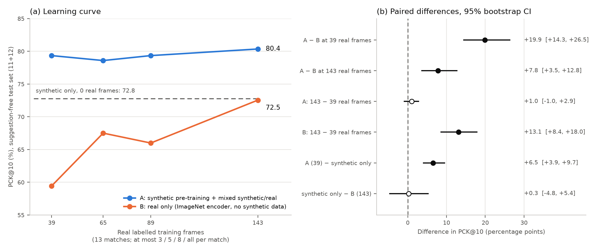

# Bird's-Eye View Player Localization from Football Broadcast Images

*Course project — Neural Networks, 2026*

> **Highlights**
> * Pitch calibration from a single broadcast frame with a median error of **0.22 m**; **5×** the landmark
>   accuracy of a YOLOv8-pose baseline trained on the same data (PCK@10 80.6 % vs. 15.6 %).
> * Results **replicate on an independent match** added after development (PCK@10 90.9 %, < 1 m in 17 of 18 frames).
> * End-to-end video system: highlights in, smooth bird's-eye video out — players within **0.41–0.43 m**
>   (median) of manual ground truth, referees removed, off-pitch shots cut automatically.
> * Synthetic pre-training matches 143 hand-annotated frames on its own and makes training stable across seeds.

## Abstract

We address the problem of recovering the metric pitch positions of football players from a single
monocular broadcast frame. Since the playing surface is planar, the image-to-pitch mapping is a
homography, which we estimate from automatically detected pitch landmarks. We (i) build a dataset of
262 manually annotated broadcast frames (2,657 keypoints, 35 landmark types) from 19 matches together
with a synthetic data generator based on a virtual broadcast camera, (ii) train a ResNet-18/U-Net
heatmap regressor for landmark detection, (iii) estimate the homography robustly with RANSAC, and
(iv) project player foot points, detected with a YOLOv8 detector fine-tuned on our own role-annotated
boxes (player, goalkeeper, referee, ball), onto a top-down pitch model. On two held-out matches annotated without model assistance, the landmark detector attains
PCK@10 = 80.6 % (95 % CI 68.1–91.0) and the resulting homography localises pitch points with a mean
error below 1 m in 86.8 % of frames (median 0.22 m), whereas a YOLO-pose baseline trained on the same
data reaches 15.6 % and 26.3 %, respectively. A controlled learning-curve study shows that synthetic
pre-training is statistically indistinguishable from training on all 143 real frames, and that with
synthetic pre-training the accuracy no longer improves significantly beyond 39 real frames. All findings
replicate on an independent match annotated after development had finished, and the complete video pipeline
places players on the bird's-eye map with a median error of about 0.4 m.

## 1. Contributions

1. **Dataset.** Automatic frame selection from 19 publicly available highlight videos (10,390 candidate
   frames → 475 selected), a written annotation protocol ([docs/annotation_protocol.md](docs/annotation_protocol.md))
   and 262 annotated frames with a match-level train/validation/test split, plus 1,680 role-annotated
   bounding boxes in 95 of these frames.
2. **Bias-controlled evaluation.** We measure confirmation bias in model-assisted annotation (66 % of
   labels identical to the suggestion) and therefore annotate the headline test matches without model
   suggestions.
3. **Synthetic data.** A procedural renderer for broadcast-like views with exact labels (6,600 images).
4. **Model comparison.** Heatmap regression (own ResNet-18/U-Net) versus keypoint regression (YOLOv8-pose)
   under identical data and evaluation.
5. **Learning-curve study** with matched compute budgets and paired bootstrap confidence intervals.
6. **End-to-end system** for images and videos, including a web interface.

## 2. Method

```
frame ─┬─► landmark heatmaps (ResNet-18 + U-Net) ─► RANSAC homography H ─┐
       └─► person/ball detection (YOLOv8) ─► team assignment (K-means) ───┴─► foot point × H ─► pitch map
```

* **Geometry.** For points on the ground plane the pinhole model reduces to a homography,
  `H = K [r1 r2 −RC]`. Players are therefore projected through their foot point (bottom centre of the
  bounding box); projecting the box centre would introduce a systematic error of 4.2 m (median, §5.4).
* **Pitch template.** 105 × 68 m, 35 landmarks; two landmark types (centre-circle extremes, penalty-arc
  tops) were added to avoid collinear configurations observed in close-ups.
* **Landmark detector.** ImageNet-initialised ResNet-18 encoder, U-Net decoder with skip connections,
  35 output heatmaps at 1/4 resolution (Gaussian targets, σ = 2), foreground-weighted MSE loss
  `(t − h)²(1 + 20h)`, sub-pixel peak localisation by log-parabola fitting.
* **Homography.** RANSAC over the detected landmarks, minimum of 5 inliers, rejection of degenerate
  (collinear) inlier sets.
* **Video.** Frame sampling at 12 fps, scene-cut detection by HSV-histogram Bhattacharyya distance, a
  homography filter with jump rejection and point-space smoothing, ByteTrack player tracking with per-track
  speed-adaptive position smoothing, and track-level role and team assignment. On 27 annotated frames the
  video pipeline places about 82 % of the players on the map with a median error of 0.43 m
  ([results §8](docs/results.md#8-temporal-stability-in-video)).

Full description: [docs/method.md](docs/method.md).

## 3. Data and experimental protocol

| Split | Matches | Annotated frames | Annotation mode |
|---|---|---|---|
| Train | 13 | 143 | model-assisted / pre-label + human review |
| Validation | 3 (02, 10, 19) | 60 | model-assisted / pre-label + human review |
| Test (with suggestions) | 1 (04) | 18 | model-assisted — reported separately |
| **Test (suggestion-free)** | **2 (11, 12)** | **41 (397 keypoints)** | **manual + geometric proposals only** |

* The split is by match to prevent leakage between near-duplicate frames; venues do not overlap across splits.
* **Metrics.** PCK@k: fraction of annotated keypoints predicted within k pixels (image width normalised to
  1280 px; missed keypoints count as errors). *Calibration success*: a homography is found from the
  predicted keypoints **and** the annotated keypoints, projected with it, lie on average < 1 m from their
  true pitch positions.
* **Uncertainty.** 95 % confidence intervals from a frame-level bootstrap (10,000 resamples, frames are the
  sampling unit because keypoints within a frame are correlated). Model comparisons use the paired bootstrap
  on identical resamples. Code: `src/guven_araligi.py`.

## 4. Results

### 4.1 Landmark detection and calibration (suggestion-free test set, matches 11 + 12)

| Model | Training data | PCK@10 [95 % CI] | Median error (px) | Calibration success < 1 m [95 % CI] |
|---|---|---|---|---|
| YOLOv8s-pose | synthetic + real | 15.6 [9.2, 22.7] | 16.3 | 26.3 [13.2, 41.0] |
| ResNet-18/U-Net | synthetic only | 72.8 [60.4, 83.5] | 3.1 | 78.9 [65.7, 91.7] |
| ResNet-18/U-Net | real only (143 frames) | 72.5 [58.7, 84.5] | 2.9 | 78.9 [65.0, 91.7] |
| **ResNet-18/U-Net** | **synthetic + real** | **80.6 [68.1, 91.0]** | **2.7** | **86.8 [75.6, 97.3]** |

The difference between the U-Net and YOLO-pose is +65.0 points PCK@10 (paired 95 % CI [+53.5, +76.0]).
**Independent replication:** on a match added only after development had finished (match 20, 18 frames
annotated without suggestions) the U-Net reaches PCK@10 = 90.9 % [81.3, 97.0] and < 1 m in 17 of 18 frames;
all paired differences replicate (U-Net − YOLO-pose +65.1; synthetic pre-training +8.0 at 143 frames;
[results §2.1](docs/results.md#21-independent-replication-on-a-new-match)).
Marginal intervals are wide because frame difficulty varies strongly; it affects all models alike, so
comparisons are made with paired intervals. On test match 04, annotated with model suggestions, the same
model scores PCK@10 = 89.7 % and 100 % calibration success, which quantifies the optimism of
suggestion-based ground truth.

### 4.2 Learning curve

All runs use the same compute budget (12 epochs of ≈ 1,930 images; real frames are oversampled), nested
subsets of at most 3 / 5 / 8 / all real frames per training match (39 / 65 / 89 / 143 frames), and are
evaluated on the suggestion-free test set. The synthetic-only model was trained separately and is shown as
a reference, not as a point of either curve.



*Filled markers: paired 95 % CI excludes zero; hollow markers: no significant difference.*

* Synthetic pre-training improves PCK@10 by +19.9 points at 39 real frames and by +7.8 points at
  143 real frames (both significant).
* With synthetic pre-training, increasing the real data from 39 to 143 frames yields +1.0 point
  (95 % CI [−1.0, +2.9]); without it, +13.1 points ([+8.4, +18.0]).
* The synthetic-only model and the model trained on all 143 real frames without synthetic data do not
  differ significantly (+0.3, [−4.8, +5.4]).
* Repeating every run with three training seeds confirms these findings and shows that synthetic
  pre-training also stabilises training: seed-to-seed spread 0.2–0.6 points with it, up to 5.6 points without.

### 4.3 Player and referee detection

A YOLOv8m detector fine-tuned at 1536 px on 1,680 own box annotations (95 frames) with the roles player,
goalkeeper, referee and ball (variant selected on validation matches) raises person AP50 on the test matches
from 0.800 (COCO model) to 0.930 (paired 95 % CI of the difference [+0.069, +0.190]), mainly by ignoring
spectators and staff (precision 0.49 → 0.87). 14 of 15 detected referees are recognised and removed from the
bird's-eye map, and 23 of 25 on the independent match 20 (full role statistics in
[results §6](docs/results.md#6-player-referee-and-ball-detection)).

**End-to-end player map (video pipeline).** Against manual ground truth, the complete video pipeline places
about 82 % of the players within 3 m once a shot has started (median error 0.43 m). On the independent
match 20 it places 91.5 % of the players in the 17 frames with a map (median 0.41 m, 90th percentile 1.08 m);
speed-adaptive smoothing (0.59 → 0.41 m) and the referee removal (68 % → 20 % visible) replicate
([results §8.2](docs/results.md#82-player-map-accuracy-end-to-end-video-pipeline)).

### 4.4 Player position: foot point versus box centre

On 251 frames with homographies from manual annotations (mean error < 0.5 m), projecting the bounding-box
centre instead of the foot point displaces 5,081 players by a median of **4.2 m** (90th percentile 6.6 m),
about twenty times the calibration error.

Complete tables, detection statistics and a per-frame error analysis: [docs/results.md](docs/results.md).

## 5. Scope and future work

* **Camera views.** The system is designed for the main broadcast camera. Close-ups and low goal-line views
  show too few pitch markings to calibrate; the video pipeline detects and removes these shots. Extending
  the synthetic generator to such views is a natural next step.
* **Roles.** Player roles are learned from kit appearance with 65 annotated training frames. Referees
  generalise to new matches; goalkeepers in kits not seen in training are labelled as players (they remain
  on the map). More kit variety or position-based cues would close this gap.
* **Ball.** The project targets player positions. The ball is detected but not drawn on the map, because an
  airborne ball does not lie on the ground plane assumed by the homography.
* **Evaluation size.** Test sets are small (41 + 18 frames from 3 matches); all results carry bootstrap
  confidence intervals, and the main findings were confirmed on an independent match and with three
  training seeds.

## 6. Reproduction

```bash
python -m venv .venv
.venv\Scripts\activate                       # Linux/macOS: source .venv/bin/activate
pip install -r requirements.txt --extra-index-url https://download.pytorch.org/whl/cu128
python -X utf8 src/test_homografi.py          # geometry test with a known synthetic camera
```

| Step | Command |
|---|---|
| Frame selection | `python -X utf8 src/kare_cikar.py` |
| Synthetic data | `python -X utf8 src/sentetik.py --train 6000 --val 600` |
| Synthetic pre-training | `python -X utf8 src/unet_keypoint.py --veri data/synthetic --ad sentetik_v1 --epoch 12` |
| Training sets | `python -X utf8 src/veri_hazirla.py --ad v2 --sentetik 1500 --cogalt 3` |
| Training | `python -X utf8 src/unet_keypoint.py --veri data/real_kp_v2 --ad v2 --epoch 12 --lr 3e-4 --baslangic models/unet_kp_sentetik_v1.pt` |
| Evaluation | `python -X utf8 src/deney_degerlendir.py models/unet_kp_v2.pt` |
| Confidence intervals | `python -X utf8 src/guven_araligi.py` |
| Figures | `python -X utf8 src/ogrenme_egrisi_ciz.py` |
| Video stability | `python -X utf8 src/video_titreme.py` |
| Detector training / evaluation | `python -X utf8 src/kutu_veri_hazirla.py` → `src/egit_tespit.py` → `src/tespit_degerlendir.py` |
| Inference (image / video) | `python -X utf8 src/sistem.py --model models/unet_kp_gercek_v1.pt --video match.mp4` |
| Web demo (English UI) | `python -X utf8 src/arayuz.py` → http://127.0.0.1:7860 |

Hardware: NVIDIA RTX 4070 Laptop GPU (8 GB), 15 GB RAM. Exact package versions are listed in
`requirements.txt`. Detailed instructions: [docs/usage.md](docs/usage.md). Source identifiers and comments
are in Turkish; a glossary is provided in the usage guide.

## 7. Repository structure

```
src/        implementation (geometry, data tools, models, evaluation, system, interface)
docs/       method, annotation protocol, results, usage
results/    evaluation outputs (JSON) and figures generated from them
data/       match-level split (bolme.json) and list of video sources (raw_videos/kaynaklar.csv)
```

## 8. Data availability and ethics

The source videos are publicly available highlight videos; their URLs, competitions and venues are listed
in `data/raw_videos/kaynaklar.csv`. Broadcast footage and frames are copyrighted by the broadcasters and
are not redistributed. The annotations and trained weights are available to the course instructors on
request. Synthetic data can be regenerated with the provided generator. The pre-labelling procedure used
for part of the training and validation data (§3) was approved by the course instructors; every
annotation file records the mode by which it was produced.

## References

1. Fischler, M. A., & Bolles, R. C. (1981). Random sample consensus: A paradigm for model fitting with
   applications to image analysis and automated cartography. *Communications of the ACM*, 24(6), 381–395.
2. Hartley, R., & Zisserman, A. (2004). *Multiple View Geometry in Computer Vision* (2nd ed.). Cambridge
   University Press.
3. He, K., Zhang, X., Ren, S., & Sun, J. (2016). Deep residual learning for image recognition. *CVPR*.
4. Ronneberger, O., Fischer, P., & Brox, T. (2015). U-Net: Convolutional networks for biomedical image
   segmentation. *MICCAI*.
5. Tompson, J., Jain, A., LeCun, Y., & Bregler, C. (2014). Joint training of a convolutional network and a
   graphical model for human pose estimation. *NeurIPS*.
6. Homayounfar, N., Fidler, S., & Urtasun, R. (2017). Sports field localization via deep structured models.
   *CVPR*.
7. Giancola, S., Amine, M., Dghaily, T., & Ghanem, B. (2018). SoccerNet: A scalable dataset for action
   spotting in soccer videos. *CVPR Workshops*.
8. Somers, V., et al. (2024). SoccerNet Game State Reconstruction: End-to-end athlete tracking and
   identification on a minimap. *CVPR Workshops*.
9. Jocher, G., Chaurasia, A., & Qiu, J. (2023). *Ultralytics YOLOv8* [Computer software].
   https://github.com/ultralytics/ultralytics
10. Efron, B., & Tibshirani, R. J. (1993). *An Introduction to the Bootstrap*. Chapman & Hall.
