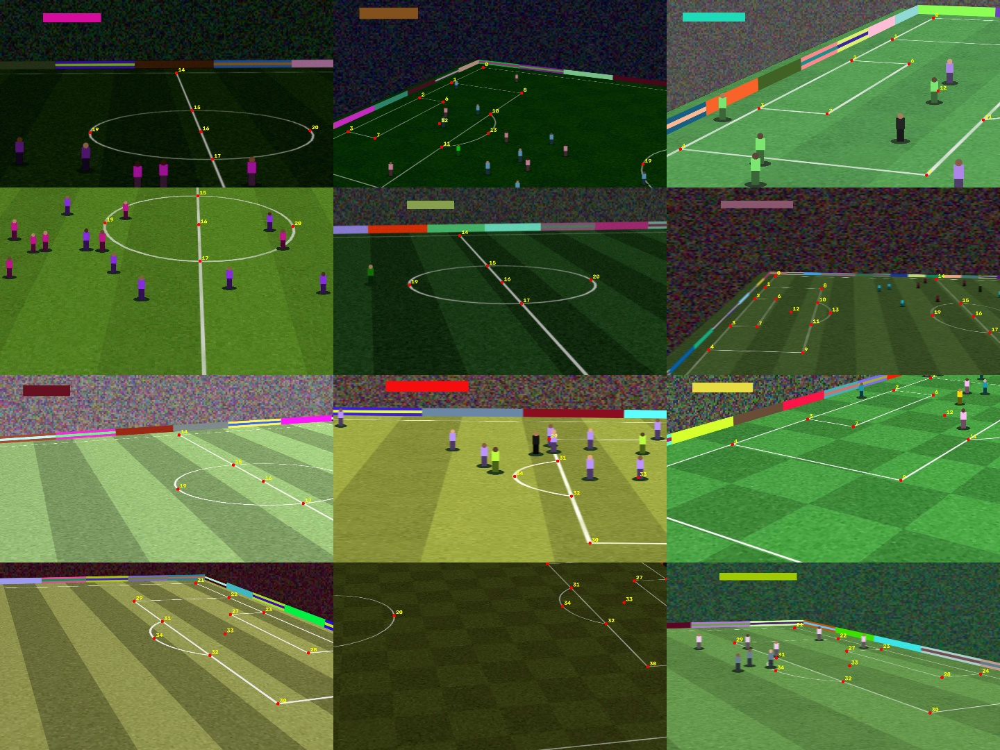

# Method

## 1. Why a homography is enough

A broadcast camera is a pinhole camera: `p ~ K R (X − C)`. All pitch points lie on the ground plane
(`z = 0`), so the projection collapses to a 3×3 homography `H = K [r1  r2  −RC]` between image pixels and
pitch metres. No full 3D calibration is needed **as long as the projected point is on the ground** —
which is why the system maps each player's **foot point** (bottom-centre of the bounding box), not the box
centre. The box centre is ~0.9 m above the grass; with a camera tilted 10–15° this shifts the player by
0.9 / tan(12°) ≈ 4 m on the map (measured median: 4.2 m, see [results, §5](results.md#5-foot-point-vs-box-centre)).
The ball in the air violates the assumption and is a known limitation.

## 2. Pitch template (`src/pitch.py`)

* FIFA dimensions 105 × 68 m, origin at the top-left corner (matches image conventions).
* **35 keypoints**: pitch corners, penalty box and goal area corners, penalty arc ends **and arc tops**,
  penalty spots, half-way line points and centre circle points.
* Design decisions driven by failure cases:
  * the half-way line points are collinear → the left/right extremes of the centre circle were added;
  * in close-ups of the penalty area, points 8-10-11 stayed collinear → the top of the penalty arc was added.
* A left↔right correspondence table (`flip_idx`) allows horizontal-flip augmentation.

## 3. Dataset (own work)

### 3.1 Sources
19 publicly available highlight videos (2–20 min, mostly 1920×1080, one 4K), 7 competitions, 8 broadcasters.
Full list with links: `data/raw_videos/kaynaklar.csv`.

### 3.2 Automatic frame selection (`src/kare_cikar.py`)
One frame per second is inspected (10,390 frames, ~173 min) and filtered:

| Filter | Rule | Rejected |
|---|---|---|
| Is there a pitch? | HSV green ratio ≥ 0.40 in the lower 2/3 (hue 25–90) | 25.5 % |
| Wide shot? | YOLO: ≥ 4 people and median person height < 20 % of image height | 14.9 % |
| New content? | dHash Hamming distance ≥ 40/256 to the previous kept frame | 4.1 % |
| Sharp? | Variance of Laplacian ≥ 60 | 0.2 % |
| **Candidates** | | **55.3 %** (5,743) |
| Balance | at most 25 frames per match, evenly spread in time | **475 selected** |

Lessons: the green ratio alone could not reject close-ups (green goalkeeper shirts, feet on grass) → the
person-size filter raised the usable ratio from ~50 % to ~85 %. One summer match had yellowish grass
(hue ≈ 32) → hue range widened.

### 3.3 Split (`src/bolme.py`, `data/bolme.json`)
Split **by match**, not by frame (frames of the same match are near-duplicates → leakage):
13 train / 3 val (02, 10, 19) / 3 test (04, 11, 12) matches. Compilation videos are kept with their matches,
the same stadium never appears in two splits, non-105×68 pitches go to train, the test set spans three
competitions and deliberately includes a hard case.

### 3.4 Labelling (`src/etiketle.py`, protocol in [annotation_protocol.md](annotation_protocol.md))
A custom OpenCV tool with zoom/pan, live homography error and per-point outlier highlighting.

| Mode | Frames | Points | Where |
|---|---|---|---|
| Model-assisted (model suggestion → human corrects) | 156 | 1,596 | train 01–07, val 02, 10, test 04 |
| **Suggestion-free** (human + geometric suggestion only) | 41 | 397 | **test 11, 12** |
| Automatic pre-label + human review | 65 | 664 | val 19, train 08, 09, 13–18 (8 frames/match) |

70 further frames were opened but skipped as unusable (close-ups, replay graphics, behind-the-goal angles).

**Confirmation bias was measured, not assumed.** In test match 04 (labelled with suggestions) 66 % of the
final labels were identical to the suggestion, which inflates the score of the model that produced them.
Therefore matches 11 and 12 were labelled **without** model suggestions: the tool hides them, the labeller
places 4–5 points, and further points are suggested only geometrically from the homography (points whose
Monte-Carlo uncertainty exceeds 3 px are not suggested). **11 + 12 is the headline test set.**

Automatic pre-labels: model suggestion → only RANSAC inliers with < 1 m error kept → visual check → human
review (`etiketle.py --kontrol`); the human added 33 missing points in 19 of 91 reviewed frames.
This procedure was approved by the course staff and is reported transparently.

Automatic QA (`src/etiket_kontrol.py`): every label set is checked for homography consistency; points with
> 1.5 m reprojection error are flagged for review (typically a wrong keypoint ID).

## 4. Synthetic data (`src/sentetik.py`)

A virtual broadcast camera is placed 15–45 m behind the near touchline at 10–30 m height with a 10°–60°
field of view, looking at a rendered 3D pitch: grass texture (colour, mowing stripes, lighting), worn lines,
3D advertising boards, player figures, plus degradations (blur, noise, JPEG artefacts, score graphics).
Labels follow exactly from the camera model. 6,000 train + 600 val images.

## 5. Models

### 5.1 Own model: ResNet-18 + U-Net heatmaps (`src/unet_keypoint.py`)
* Encoder: ImageNet-pretrained ResNet-18; decoder: U-Net style upsampling with skip connections.
* Output: 35 heatmaps at 1/4 input resolution, Gaussian targets with σ = 2.
* Loss: weighted MSE `(t − h)² · (1 + 20·h)` — up-weights the few foreground pixels.
* Sub-pixel decoding: log-parabola fit around the peak (unit-tested: 0.0 px bias; an earlier
  half-pixel shift and a clipped weighted average had 5.5 px and 2.4 px bias).
* AdamW + OneCycle, mixed precision.
* Training recipe used for the final model: pre-train on synthetic data, then fine-tune on a mix of
  real frames (oversampled) and 1,500 synthetic images.

### 5.2 Baseline: YOLO-pose (`src/egit_keypoint.py`)
"Object = pitch, joints = 35 keypoints" with YOLOv8s-pose; mosaic off, horizontal flip with `flip_idx`.
It is a two-stage design: the pitch *box* must be detected before any keypoint is produced. On real images
that box confidence collapsed, so the synthetic-only model produced no keypoints at all; fine-tuning on
real data helped but its keypoints stay coarse (box-relative regression at 640 px vs. full-resolution heatmaps).

### 5.3 Players and teams (`src/oyuncu.py`)
YOLOv8m at 1280 px input, fine-tuned from COCO on our box annotations with four role classes — player,
goalkeeper, referee, ball (`src/kutu_veri_hazirla.py`, `src/egit_tespit.py`; protocol in
[annotation_protocol.md](annotation_protocol.md), Part B). Referees (including assistant referees) are
detected but not drawn on the bird's-eye map. The COCO model (`person`, `sports ball`) remains available as a
baseline. Team assignment applies to the player class only: torso region of each box, grass pixels masked
out in HSV, median colour, K-means (k = 2) in Lab space; the map shows each team in its real jersey colour.

## 6. Homography estimation (`src/homografi.py`, `src/keypoint_tahmin.py`)

* RANSAC over predicted keypoints; at least 5 inliers and a non-degeneracy (non-collinearity) check on the inliers.
* Error is reported on inliers only (an early version averaged outliers in and showed 9.7 m for a 0.20 m calibration).
* Sign normalisation of `H` so that projected points have positive depth (frames showing the horizon
  previously produced NaN).

## 7. Video pipeline (`src/sistem.py`)

* Frames are sampled at a target rate (default 12 fps; every 5th frame of a 60 fps video).
* **Scene cuts**: Bhattacharyya distance between HSV (hue × saturation) histograms of consecutive sampled
  frames > 0.35 resets the temporal state. Measured on three videos: within a shot ≤ 0.26, real cuts ≥ 0.46.
  (dHash was tried first and found 25 false cuts in 10 s of continuous play — uniform grass makes it unstable.)
* **Homography filter** (`src/takip.py`, `HomografiFiltresi`). A fixed grid of 6 × 4 image points
  (lower 65 % of the frame) is projected to the pitch with each new `H`.
  * *Jump rejection*: if the median displacement of the grid relative to the current estimate exceeds
    3 m, the new `H` is discarded; if 3 consecutive rejected estimates agree with each other, they are
    accepted as genuine camera motion.
  * *Smoothing in point space*: the projected grid positions are averaged exponentially (α = 0.5) and `H`
    is re-estimated from the averaged correspondences. This replaces the earlier element-wise averaging of
    `H` matrices (α = 0.3), which has no geometric meaning and proved unstable on one validation clip (§8 of
    the results).
  * If no homography is found, the previous one is reused for up to 6 sampled frames; otherwise the frame is
    rendered with a greyed-out map and the label "saha görünmüyor" (pitch not visible).
* **Player tracking** (`oyunculari_takip_et`, ByteTrack via Ultralytics). Detections are associated over time
  with a Kalman-filter motion model and two-stage matching (high- then low-confidence boxes), giving each
  player a persistent identity. The tracker is reset at scene cuts.
* **Position smoothing** (`OyuncuTakipci`). Per identity, pitch positions are averaged exponentially
  (β = 0.4; no smoothing for the ball). A single-frame jump > 4 m is ignored as an association or detection
  error; tracks unseen for up to 6 frames are held at their last position; the last ~1.5 s are drawn as a trail.
* **Persistent team assignment** (`TakimAtayici`). Two team colour centres are initialised by K-means at the
  start of a shot and then updated slowly (rate 0.05); each player is assigned to the nearest centre, with a
  majority vote over its last 15 frames. A colour farther than 2.5 × the typical within-team spread from both
  centres is labelled *other* (referees, goalkeepers). This removes frame-to-frame colour flicker.
* Output is piped to `ffmpeg` (H.264, yuv420p, faststart) so it plays directly in the browser.
* Throughput on an RTX 4070 Laptop: ~0.15 s per processed frame → a 1-minute highlight takes ~1.5–2 min.
