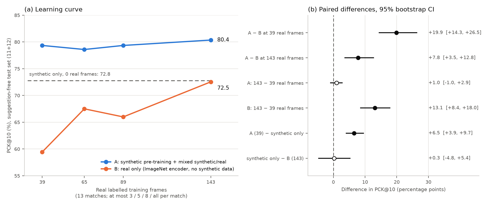

# Results

All numbers are produced by scripts in `src/` and stored in `results/deneyler.json`,
`results/guven_araligi.json` and `results/ayak_analizi.json`. Unless stated otherwise, the test set is
**matches 11 + 12, labelled without model suggestions** (41 frames, 397 keypoints). Pixel errors are
rescaled to a 1280 px image width.

**Statistical treatment.** Keypoints within a frame share camera, lighting and occlusions and are not
independent; the frame is therefore the sampling unit. 95 % confidence intervals (CI) are percentile
intervals of a frame-level bootstrap with B = 10,000 resamples (seed 0). Differences between models are
assessed with the **paired** bootstrap (both models evaluated on the same resampled frames); a difference
is called significant when its 95 % CI excludes zero. Marginal intervals are wide (≈ ±12 points) because
frame difficulty varies strongly, but this variation is shared by all models and largely cancels in the
paired comparison.

## 1. Geometry sanity check

Known synthetic camera + ±1.5 px simulated click noise → mean player position error **0.32 m**
(worst 0.56 m). This is the floor that labelling noise alone imposes (`src/test_homografi.py`).

## 2. Keypoint models

| Model | Training data | Found | Median error (px) | PCK@5 | PCK@10 | PCK@20 |
|---|---|---|---|---|---|---|
| YOLO-pose | synthetic only | 38.3 % | 39.0 | 2.0 % | 4.0 % | 9.8 % |
| YOLO-pose | synthetic + real (143) | 50.1 % | 16.3 | 4.8 % | 15.6 % | 29.5 % |
| U-Net (own) | synthetic only | 82.6 % | 3.1 | 59.9 % | 72.8 % | 76.6 % |
| U-Net (own) | real only (143) | 76.8 % | 2.9 | 60.2 % | 72.5 % | 75.6 % |
| **U-Net (own)** | **synthetic + real (93), v1** | **88.9 %** | 2.7 | 68.3 % | **80.6 %** | **85.6 %** |
| U-Net (own) | synthetic + real (143), v2 | 88.2 % | **2.6** | **68.8 %** | 80.4 % | 84.6 % |

95 % CI of PCK@10 (frame bootstrap): YOLO-pose synthetic + real [9.2, 22.7]; U-Net synthetic only
[60.4, 83.5]; U-Net real only [58.7, 84.5]; U-Net v1 [68.1, 91.0]; U-Net v2 [67.4, 91.0].
U-Net v1 − YOLO-pose: +65.0 points, paired CI [+53.5, +76.0].

*Found* = fraction of labelled keypoints for which the model output a prediction above the confidence
threshold; median error is computed over found keypoints only; PCK@k = fraction of **all** labelled
keypoints predicted within k px (missed keypoints count as failures).

**Findings**
* The heatmap U-Net beats YOLO-pose by a wide margin. YOLO-pose regresses keypoints relative to an object
  box at 640 px; the U-Net produces a full-resolution heatmap per keypoint with a sub-pixel peak. For one
  image-filling "object" with 35 thin landmarks the heatmap formulation is clearly the better fit.
* On test match 04 — labelled *with* model suggestions — the same U-Net scores PCK@10 89.7 % and 100 % of
  frames < 1 m: the measured effect of confirmation bias. Headline numbers therefore use 11 + 12.

## 3. Learning curve (research question)

**Questions.** (Q1) Does synthetic pre-training improve landmark detection on real broadcast frames?
(Q2) How does accuracy scale with the number of real annotated frames, with and without synthetic data?

**Design.** Two training regimes are compared at four amounts of real data:

* **A** — initialise from the synthetic-only model, train on real frames mixed with 1,500 synthetic images;
* **B** — initialise the encoder from ImageNet, train on real frames only.

Real data: at most 3 / 5 / 8 / all frames per training match (13 matches → 39 / 65 / 89 / 143 frames;
some matches have fewer than 8 annotated frames). Subsets are nested (same seed). Every run receives the
same compute budget: 12 epochs of ≈ 1,930 images, obtained by oversampling the real frames, so that
differences reflect the data and not the number of optimisation steps.

**Reference.** The synthetic-only model (0 real frames) was trained in a separate run with a different
schedule; it is therefore reported as a reference level and **not** as the first point of curve A.

**PCK@10 (%) with 95 % CI**

| Real frames | 39 | 65 | 89 | 143 |
|---|---|---|---|---|
| A: synthetic pre-training + mix | 79.3 [66.2, 90.2] | 78.6 [65.4, 89.5] | 79.3 [66.1, 90.1] | 80.4 [67.4, 91.0] |
| B: real only | 59.4 [47.2, 71.2] | 67.5 [54.7, 79.2] | 66.0 [52.5, 78.3] | 72.5 [58.7, 84.5] |
| Reference: synthetic only (0 real frames) | 72.8 [60.4, 83.5] | | | |

**Paired differences in PCK@10 (percentage points, 95 % CI)**

| Comparison | Difference | 95 % CI | Significant |
|---|---|---|---|
| A − B at 39 real frames | +19.9 | [+14.3, +26.5] | yes |
| A − B at 143 real frames | +7.8 | [+3.5, +12.8] | yes |
| A: 143 − 39 real frames | +1.0 | [−1.0, +2.9] | no |
| B: 143 − 39 real frames | +13.1 | [+8.4, +18.0] | yes |
| A (39 real frames) − synthetic only | +6.5 | [+3.9, +9.7] | yes |
| synthetic only − B (143 real frames) | +0.3 | [−4.8, +5.4] | no |

*(a) PCK@10 versus the number of real training frames; dashed line: synthetic-only reference.
(b) Paired differences with 95 % bootstrap CI; filled markers: CI excludes zero.*

**Findings.**

1. **Q1 — synthetic pre-training helps at every data size**, most strongly in the low-data regime
   (+19.9 points at 39 frames, +7.8 points at 143 frames).
2. **Q2 — with synthetic pre-training, accuracy saturates early.** Adding 104 real frames beyond 39 yields
   no significant improvement (+1.0, CI [−1.0, +2.9]). Without synthetic data, accuracy still increases
   significantly over the same range (+13.1).
3. **Real data remains necessary.** Fine-tuning on only 39 real frames improves significantly over the
   synthetic-only model (+6.5), i.e. synthetic data narrows but does not close the domain gap.
4. **Synthetic data alone versus 143 real frames alone:** no significant difference (+0.3, CI [−4.8, +5.4]).
   This is a non-significant difference, not a demonstrated equivalence; the interval admits differences of
   about ±5 points. The statement "synthetic data is worth about 140 real frames" should be read in this sense.
5. Non-monotonic steps (A: 79.3 → 78.6; B: 67.5 → 66.0) lie well within sampling noise (1 point ≈ 4 keypoints).

Since curve A is flat beyond 39 frames, the remaining error is attributed to localisation precision rather
than data quantity (PCK@5 ≈ 69 % versus PCK@20 ≈ 85 %).

**Training randomness (3 seeds).** The bootstrap intervals above capture test-set sampling only. Every run of
the learning curve was repeated with two further training seeds (same data subsets, recipe and budget;
`results/logs/tohum_tekrar.ps1`, `src/tohum_ozet.py`, `results/tohum_ozet.json`). PCK@10 (%), mean ± standard
deviation over 3 seeds:

| Real frames | 39 | 65 | 89 | 143 |
|---|---|---|---|---|
| A: synthetic pre-training + mix | 79.3 ± 0.2 | 78.7 ± 0.2 | 79.1 ± 0.4 | 80.4 ± 0.6 |
| B: real only | 55.6 ± 5.6 | 65.3 ± 4.7 | 64.6 ± 1.7 | 71.2 ± 1.7 |

* The findings hold across seeds: curve A stays flat (+1.2 points from 39 to 143 frames), curve B keeps
  rising (+15.6), and A exceeds B by 23.7 points at 39 frames and 9.2 points at 143 frames on average.
* **Synthetic pre-training also stabilises training:** the seed-to-seed spread of A is 0.2–0.6 points, that of
  B up to 5.6 points with little data (one seed reached only 49.1 % at 39 frames). The single-seed B values
  reported above (59.4 / 67.5 / 66.0 / 72.5) were therefore somewhat favourable for B.
* The synthetic-only model (72.8) and B at 143 frames (71.2 ± 1.7, range 69.3–72.5) remain comparable.

## 4. End-to-end error in metres

The homography is fitted from the **model's** keypoints; the **hand-labelled** points are then projected
with it and compared with their true pitch positions. Only frames whose labels alone can define a
homography are counted. Success = homography found **and** mean error < 1 m.

| Model | Test | Frames | Homography found | Median error | Success (< 1 m) |
|---|---|---|---|---|---|
| YOLO-pose (synthetic + real) | 11+12 | 38 | 50 % | 0.97 m | 26 % |
| U-Net (synthetic only) | 11+12 | 38 | 92 % | 0.27 m | 79 % |
| U-Net (real only) | 11+12 | 38 | 82 % | 0.21 m | 79 % |
| **U-Net (synthetic + real, v1)** | **11+12** | 38 | **89 %** | **0.22 m** | **87 %** |
| U-Net (synthetic + real, v2) | 11+12 | 38 | 89 % | 0.22 m | 87 % |
| U-Net (synthetic + real, v1) | 04 (with suggestions) | 17 | 100 % | 0.29 m | 100 % |

95 % CI of the success rate (frame bootstrap): YOLO-pose [13.2, 41.0]; U-Net synthetic only [65.7, 91.7];
U-Net real only [65.0, 91.7]; U-Net v1 and v2 [75.6, 97.3].

When a homography is found, the error (~0.2 m) is close to the click-noise floor of section 1. Most remaining
failures are frames where no consistent homography exists at all.

## 5. Foot point vs. box centre

Homographies from **hand labels** (mean error < 0.5 m) on 251 real frames; 5,081 player boxes, foot point
and box centre projected separately.

| | Median | Mean | 90th pct. | Max |
|---|---|---|---|---|
| Box centre − foot point distance | **4.2 m** | 4.4 m | 6.6 m | 13.5 m |

The box centre would introduce a systematic error ~20× larger than the model's own error (~0.2 m), and it
grows for distant players (flatter viewing angle). The share of positions inside the pitch also drops
(77 % → 74 %).

## 6. Player, referee and ball detection

### 6.1 Fine-tuned detector versus COCO baseline

Box annotations: 95 frames (5 per match), 1,680 boxes (1,422 players, 120 referees, 67 goalkeepers,
71 balls), split by match like the keypoints (train 65 / val 15 / test 15 frames). YOLOv8m initialised from
COCO was fine-tuned on the training frames; checkpoints are selected on validation.

**Variants and selection (validation matches only).** Three variants were trained; the choice was made on
the validation frames by the mean AP50 of the four role classes, before looking at the test frames
(`tespit_degerlendir.py --secim`, `results/tespit_val_secimi.json`):

| Variant | Change | Val AP50: player / goalkeeper / referee / ball | Mean |
|---|---|---|---|
| v1 | 1280 px, 80 epochs | 0.834 / 0.432 / 0.217 / 0.556 | 0.510 |
| v2 | frames containing a goalkeeper oversampled ×3, 35 epochs (same number of optimisation steps) | 0.830 / 0.606 / 0.584 / 0.626 | 0.662 |
| **v3** | **1536 px input**, 80 epochs | **0.897** / 0.536 / **0.587** / **0.661** | **0.670** |

Oversampling by frame is limited because goalkeepers appear in 42 and the ball in most of the 65 training
frames; the imbalance is at the instance level (≈ 1 goalkeeper per 15 players). Higher input resolution
helps the small ball. v2 and v3 are close on 15 validation frames; v3 was selected by the pre-defined criterion.

**Test results** (15 frames of matches 04, 11, 12; `src/tespit_degerlendir.py`, `results/tespit.json`; v1 in
`results/tespit_futbol_v1.json`). Because the COCO model has no role classes, the comparison uses the two tasks
all models share: *person* (player, goalkeeper and referee merged) and *ball*. Operating point: confidence
≥ 0.25. Differences to COCO: paired frame bootstrap, B = 5,000.

| | Person AP50 | Person AP50-95 | Person recall / precision | Ball AP50 | Ball recall / precision |
|---|---|---|---|---|---|
| COCO YOLOv8m | 0.800 | 0.777 | 0.90 / 0.49 | 0.631 | 0.80 / 0.33 |
| Fine-tuned v1 | 0.934 | 0.793 | 0.94 / 0.80 | 0.545 | 0.50 / 0.83 |
| **Fine-tuned v3 (selected)** | **0.930** | 0.783 | 0.91 / **0.87** | **0.737** | 0.70 / 0.64 |
| v3 − COCO [95 % CI] | **+0.130 [+0.069, +0.190]** | | | +0.106 [−0.041, +0.292] | recall −0.10 [−0.33, 0.00] |

* **Person detection improves significantly**, mainly through precision: the COCO model also detects
  spectators, staff and ball boys, which the annotation protocol treats as negatives.
* **Ball:** v3 reaches the highest ball AP50, but the difference to COCO is not significant — the test set
  contains only 10 balls. v3 trades some recall (0.70 vs 0.80) for far fewer false balls (precision 0.64 vs 0.33).
* **Role classes** (v3), AP50: player 0.912, referee 0.751, goalkeeper 0.564, ball 0.737.

**Referee separation** (v3; detected persons at confidence ≥ 0.25 matched to ground truth; rows: true role,
columns: predicted role):

| | player | goalkeeper | referee |
|---|---|---|---|
| player (201) | 196 | 2 | 3 |
| goalkeeper (10) | 3 | 7 | 0 |
| referee (15) | 1 | 0 | **14** |

14 of 15 detected referees (93 %) are recognised and therefore hidden on the bird's-eye map (with the COCO
model all of them appear as players); 3 of 201 players (1.5 %) are wrongly hidden. Goalkeepers (42 training
examples) remain the weakest class (7 of 10).

**Annotation bias.** 92 % of the final boxes kept the exact coordinates proposed by the COCO model. Metrics
that depend on precise box placement therefore favour the COCO model: its foot-point error with respect to the
labels is 0.00 m (median) versus 0.06 m for v3, which reflects shared coordinates, not better localisation.
AP50-95 is affected in the same direction. The reported improvements are conservative.

### 6.2 Label-free statistics of the COCO model (251 frames)

| Statistic | Value |
|---|---|
| "Person" detections per frame (median) | 20 |
| Frames with the ball detected | 59 % |
| Foot points inside the pitch (±3 m) | 77 % |

~23 % of person detections fall outside the pitch (assistant referees, ball boys, staff, front-row fans);
the homography itself is used to filter them.

## 7. Error analysis (U-Net v1 on 11 + 12)

33 of 38 frames succeed. The 5 failures:

| Frame | Outcome | Cause |
|---|---|---|
| 11 / t00003 | 8.7 m error | Very wide, high pre-match shot of the whole pitch; thin distant lines, bottom covered by graphics — outside the synthetic camera range |
| 12 / t00139 | no homography (8 inconsistent points) | Only one penalty box visible, no half-way line → which goal is ambiguous; left/right IDs mixed up (mirror symmetry) |
| 12 / t00369 | no homography (6 points) | Low angle near the goal line; players and goal net occlude the lines |
| 12 / t00046, t00105 | no homography (1–3 points) | Close-ups with too few visible landmarks |

## 8. Temporal stability in video

No ground-truth trajectories exist for the videos, but genuine motion (running, camera pans) is smooth while
jitter alternates from frame to frame. Smoothness is therefore measured by the norm of the **second
difference** of a position, `‖p(t+1) − 2p(t) + p(t−1)‖` (metres, zero for constant-velocity motion), over
consecutive sampled frames within a shot (12 fps):

* *homography jitter*: second difference of a fixed 6 × 4 image grid projected to the pitch;
* *player jitter*: second difference of the pitch position of the same tracked identity;
* *distance to raw*: distance between the smoothed and the unsmoothed position of a player in the same frame
  — a guard against over-smoothing (freezing positions would minimise jitter but maximise this distance).

Three methods are compared on the **same frames, keypoint predictions, detections and identities**:
*raw* (each frame independent), *previous* (element-wise EMA of `H`, α = 0.3, raw positions) and *new*
(homography filter with jump rejection and point-space smoothing + per-track position smoothing; §7 of the
method). The smoothing factor α ∈ {0.3, 0.5} was selected on two validation clips (matches 02 and 10): both
gave the same player jitter, α = 0.5 stayed closer to the raw positions. Results on 60 s clips from the three
test matches (`src/video_titreme.py`, `results/video_titreme.json`):

| Clip | Method | Coverage | Homography jitter, median / p90 (m) | Player jitter, median / p90 (m) | Distance to raw (m) |
|---|---|---|---|---|---|
| 12 (60–120 s) | raw | 47 % | 0.213 / 0.761 | 0.222 / 0.719 | — |
| | previous | 48 % | 0.068 / 0.198 | 0.134 / 0.437 | 0.60 |
| | **new** | 47 % | 0.099 / 0.306 | **0.067 / 0.447** | **0.32** |
| 11 (90–150 s) | raw | 79 % | 0.181 / 1.057 | 0.299 / 1.282 | — |
| | previous | 82 % | 0.050 / 0.283 | 0.148 / 0.517 | 0.51 |
| | **new** | 81 % | 0.075 / 0.453 | **0.074 / 0.526** | **0.29** |
| 04 (120–180 s) | raw | 47 % | 0.209 / 1.285 | 0.321 / 3.187 | — |
| | previous | 47 % | 0.047 / 0.326 | 0.135 / 0.867 | 0.27 |
| | **new** | 46 % | 0.079 / 0.507 | **0.063 / 1.077** | **0.20** |

* **Player jitter** (median) is reduced by a factor of ≈ 2 relative to the previous method and 3–5 relative to
  raw output, while the smoothed positions stay *closer* to the raw positions than before (0.20–0.32 m vs.
  0.27–0.60 m); the improvement is not obtained by freezing players. (With constant smoothing the jitter was
  ≈ 3× lower but the lag larger and the median position error 0.57 m instead of 0.43 m, §8.2.) The 90th
  percentile of the new method is higher on clip 04 (1.08 m), where fast camera changes occur.
* **Homography jitter** of the new filter is somewhat higher than that of the previous matrix EMA at the
  selected α (less smoothing, less lag). However, the matrix EMA is not robust: on validation clip 10 its
  90th-percentile homography jitter reached 4.06 m — worse than raw output (2.79 m) — whereas the new filter
  stayed at 0.82 m. Jump rejection was triggered 15 times on the test clips (0 / 9 / 6).
* Coverage (frames with a homography) is unchanged; it is limited by the keypoint detector, not by the
  temporal processing (very wide shots with few landmarks remain unmapped).
* Limitations of this evaluation: the metric measures smoothness, not accuracy; parameters were selected on
  two short validation clips; one run per clip.

### 8.1 Role and team label stability

Observed in the demo: the same player occasionally switched team colour, and goalkeepers and referees
alternated between their role colour and a black *other* marker (referees thereby appeared on the map). The
cause was per-frame decision making. Track-level role voting, occlusion-aware colour voting and hysteresis
(§7 of the method) were compared with the previous per-frame assignment on 40 s clips of the test matches,
with identical detections and tracks (`src/takim_tutarlilik.py`, `results/takim_tutarlilik.json`):

| Clip | Label changes per 100 track-frames, per-frame → track-level | Black *other* markers on the map, per-frame → track-level |
|---|---|---|
| 12 (60–100 s) | 2.06 → **1.30** | 2.2 % → 0 % |
| 11 (90–130 s) | 2.79 → **0.96** | 8.8 % → 0 % |
| 04 (120–160 s) | 1.76 → **0.48** | 2.3 % → 0 % |

Both rows use the same detections, tracks and the improved jersey-colour measurement (local grass model);
only the assignment logic differs (numbers after the filter fixes of §8.2). Label changes drop by 37–73 %. With the goalkeeper rules, no frame shows two
goalkeepers in the same half (previously 11 and 13 frames in clips 11 and 12). About 6 % of track-frames in
clip 11 are hidden as *other* (colour outliers or goalkeeper duplicates), some of which may be players. Remaining
label changes are largely attributable to identity switches of the tracker when players overlap.

Caveats: these clips were also used while developing this step (the hysteresis, asymmetric role rule and
goalkeeper rules were added after inspecting them; the role threshold itself was derived from validation-frame
confusion rates), so the numbers are not an independent held-out evaluation. Problems found on the way: a fixed
green-hue mask failed on yellowish grass and made both teams' colours collapse onto the grass colour; keeping
team colours across shots was tried and reverted.

### 8.2 Player map accuracy (end-to-end, video pipeline)

The goal of the project is the position of the **players**. This experiment checks what the complete video
pipeline (homography filter, tracking, smoothing, role and team rules) actually draws on the map, against
manual ground truth (`src/oyuncu_harita_olc.py`, `results/oyuncu_harita.json`):

* frames: the 27 validation and test frames that carry both box and keypoint annotations;
* the video is started ~4 s before the annotated second, so tracking and smoothing arrive "warm" at exactly
  that frame (verified by pixel difference to the annotated image);
* ground truth: foot points of the manually drawn boxes, projected with the homography from the manually
  annotated keypoints (no model involved);
* prediction: all points the pipeline draws on the map (referees and ball excluded, faint points included);
  Hungarian matching with a 3 m gate.

| Configuration | Players found | … excluding 2 first-frame-of-shot frames* | … in team colour | Referees visible ↓ | Spurious points ↓ | Position error (median) |
|---|---|---|---|---|---|---|
| A: COCO detector, per-frame assignment (previous system) | 75.1 % | 83.0 % | 98.5 % | 70.6 % | 13.9 % | 0.52 m |
| C: own detector, per-frame assignment | 75.3 % | 83.2 % | 94.8 % | 38.2 % | **11.1 %** | 0.54 m |
| B′: own detector + track-level rules, constant smoothing | 74.7 % | 82.5 % | **98.8 %** | 26.5 % | 11.5 % | 0.57 m |
| **B: as B′ + speed-adaptive smoothing (current)** | 74.4 % | 82.3 % | **98.8 %** | **23.5 %** | 12.1 % | **0.43 m** |

(27 frames, 430 players, 34 referees. 25 of the frames were never looked at while developing the video rules;
on those the numbers differ by less than 2 points. *Two annotated frames are the very first frame of a shot
— one directly after a scene cut, one at second 0 of a video. The homography filter needs two consistent
frames to start, so the map appears one sampled frame (~0.08 s) later; the second column excludes these frames.
The cropped output video drops such frames anyway.)

* **Speed-adaptive smoothing** (One-Euro-style: the smoothing factor grows with the distance between the new
  measurement and the current estimate; threshold 1 m per sampled frame chosen in advance, not tuned) reduces
  the median position error from 0.57 m to 0.43 m (frames never used during development: 0.58 → 0.42 m),
  players more than 1 m off from 21 % to 12 % and the 90th percentile from 1.35 m to 1.06 m. Its cost is
  slightly more jitter (median 0.06–0.07 m instead of 0.04–0.05 m, still half that of the previous matrix EMA)
  in exchange for less lag (distance to raw 0.20–0.32 m instead of 0.30–0.49 m).
* **Players:** about 82 % of the players are on the map when the shot has started, within 3 m and with a
  median error of about 0.43 m (90th percentile 1.06 m). The detector and the rules hardly change this. The
  largest single loss is a very wide pre-match frame whose homography is 8.7 m wrong; it is now rejected
  (no map) instead of showing 22 players in wrong places.
* **Referees:** the own detector and the track-level rules reduce visible referees from 71 % to 27 %.
* **Spurious points** (~11 %): points without a ground-truth person within 3 m — partly people not annotated
  (half-visible players at the border), partly tracks held at their last position, partly positions > 3 m off.
* Position errors differ by a few centimetres between configurations; the ground-truth boxes kept the COCO
  coordinates in 92 % of cases (annotation bias, §6), so these differences are not interpretable.

**Bugs found by this measurement.** The first run showed frames with a correct single-frame homography but an
empty or wrong video map:
1. *Sign flip*: the homography filter re-estimated `H` with `cv2.findHomography`, which normalises
   `H[2,2] = 1` and can flip the sign of `H`; the projection code interprets negative depth as "behind the
   camera" and discarded all points. Fixed with the sign normalisation used elsewhere (`isareti_duzelt`).
2. *Locking onto a wrong start*: after a scene cut the filter accepted the first homography of the shot, which
   was 46 m off in one case, and then rejected the correct ones as "jumps"; player positions were then
   smoothed slowly from the wrong to the right place. Fixes: the filter starts only after two consistent
   homographies, rejects implausible ones (fewer than 75 % of the grid points or the grid centre more than 10 m
   outside the pitch), and resets player position smoothing whenever the homography is (re)initialised or a
   jump is accepted.
The stability measurements of §8 and §8.1 were re-run after the fixes; changes are within a few hundredths of a
metre or label change per 100 track-frames.

### 8.3 Negative result: refining the homography on the pitch lines

The homography was refined by fitting the projected pitch template to the white line pixels of the image
(top-hat filter on Lab lightness inside the grass region, distance transform, 8-parameter robust least
squares with the model's RANSAC inliers as a weak anchor; `src/cizgi_iyilestir.py`). On the validation
frames the fit to the lines improved markedly (e.g. 2.7 → 0.4 px mean distance) but the error at the manually
annotated keypoints got **worse**: median 0.200 → 0.230 m, 36 frames worse and 8 better
(`results/cizgi_iyilestirme_val.json`). Only the three weakest frames (> 0.5 m) improved (mean 1.09 → 0.84 m).
Likely reasons: the model is already at the level of the annotation noise (0.20 m vs. 0.32 m click noise in the
synthetic test), and broadcast lenses bend the lines, which a homography cannot represent, so fitting all lines
spreads the error. The method was **not** adopted and the test set was not used for it.

## 9. Video demo

Juventus – Inter highlight (test match 12), 15 s at 12 processed fps: 104 of 180 frames mapped (58 %; the
rest were close-ups, crowd shots and replays, correctly marked "pitch not visible"), 3 scene cuts detected,
26 s processing time on an RTX 4070 Laptop.
